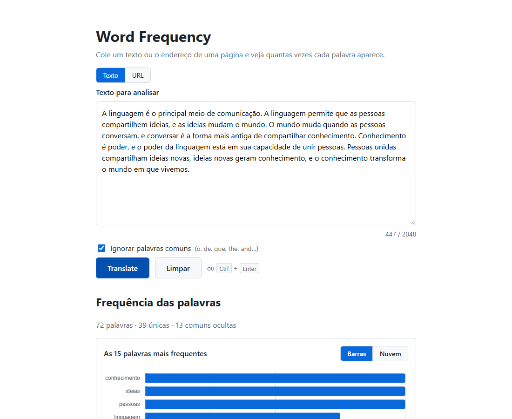
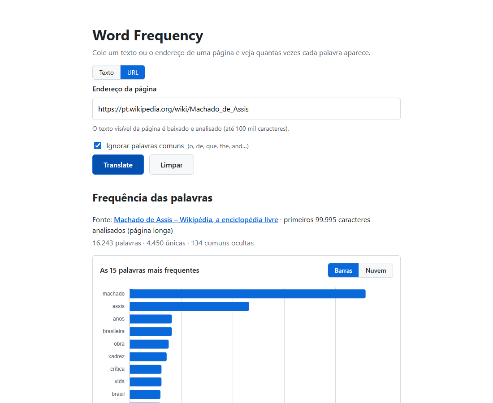

# Word Frequency

Cole um texto e veja quantas vezes cada palavra aparece, em uma tabela ordenada, num gráfico de barras e numa nuvem de palavras.

**Acesse:** https://agrosyntese.github.io/word-frequency/



## Funcionalidades

- **Contagem de palavras** de textos com até 2048 caracteres, com a tabela ordenada da palavra mais frequente para a menos frequente
- **Gráfico de barras** com as 15 palavras mais frequentes e **nuvem de palavras** com até 60
- **Ignorar palavras comuns** em português e inglês (artigos, preposições, pronomes…), para destacar as palavras que dizem do que o texto trata
- **Filtro na tabela** que ignora acentos e maiúsculas: buscar "nao" encontra "não"
- **Exportar CSV**, pronto para abrir no Excel em português
- **Analisar uma página da web pelo endereço** (só ao rodar localmente; veja [abaixo](#análise-por-url))
- Funciona no celular; atalho <kbd>Ctrl</kbd> + <kbd>Enter</kbd> para analisar


### Como as palavras são contadas

- Maiúsculas e minúsculas contam como a mesma palavra: "Casa" e "casa"
- A pontuação é descartada
- Acentos, hífens e apóstrofos internos fazem parte da palavra: "não", "guarda-chuva", "don't"
- Números contam como palavras
- Em frequências iguais, a ordem é alfabética

## Rodar localmente

Requer [Node.js](https://nodejs.org/) 22 ou mais recente.

```bash
git clone https://github.com/agrosyntese/word-frequency.git
cd word-frequency
npm install
npm run dev
```

Abra http://localhost:5173.

| Comando | O que faz |
|---|---|
| `npm run dev` | Servidor de desenvolvimento, com a análise por URL |
| `npm test` | Testes (Vitest) em modo watch; `npm test -- --run` roda uma vez |
| `npm run typecheck` | Checagem de tipos do TypeScript |
| `npm run build` | Build de produção em `dist/` |
| `npm run preview` | Serve o build localmente, também com a análise por URL |

## Análise por URL

Ao rodar localmente, o seletor **Texto | URL** permite informar o endereço de uma página. O app baixa a página, extrai o texto visível (sem menus, scripts e rodapés) e conta as palavras de até 100 mil caracteres.



O navegador não pode baixar páginas de outros sites diretamente (bloqueio de CORS), então essa busca é feita por uma função no servidor ([api/fetch-text.ts](api/fetch-text.ts)). Por isso o recurso **não aparece na versão publicada**: o GitHub Pages hospeda apenas arquivos estáticos e não roda código no servidor.

A função se protege contra uso para acessar redes internas (SSRF):

- aceita só `http` e `https`, nas portas padrão;
- bloqueia `localhost` e endereços internos e privados, inclusive quando um domínio público aponta para um deles ou quando há um redirecionamento para eles;
- usa tempo limite de 5 segundos e limite de 2 MB por página.

O arquivo segue o formato de funções serverless da Vercel, caso você queira publicar o app com a análise por URL funcionando.

## Estrutura

```
src/core/     lógica pura: contagem, palavras comuns, filtro, CSV (com testes)
src/ui/       interface: formulário, tabela, gráficos
server/       busca e extração de texto de páginas (com testes)
api/          função serverless que expõe server/ em /api/fetch-text
```

## Tecnologias

[Vite](https://vite.dev/), TypeScript, HTML e CSS sem framework, [Chart.js](https://www.chartjs.org/) com [chartjs-chart-wordcloud](https://github.com/sgratzl/chartjs-chart-wordcloud), [cheerio](https://cheerio.js.org/) e [Vitest](https://vitest.dev/).

## Publicação

Cada envio para o branch `main` dispara o workflow [deploy.yml](.github/workflows/deploy.yml). Ele roda a checagem de tipos e os testes, gera o build sem a análise por URL e publica no GitHub Pages.

## Origem

Projeto baseado na especificação *Word Frequency* do repositório [app-ideas](https://github.com/florinpop17/app-ideas).
